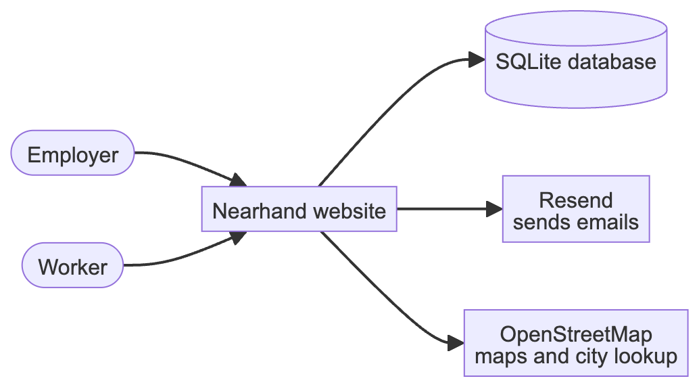
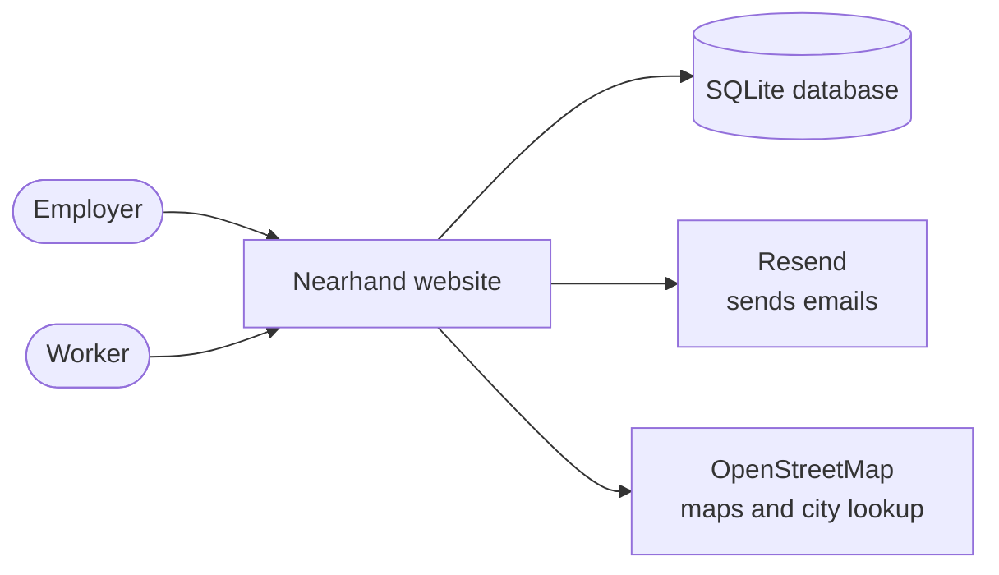
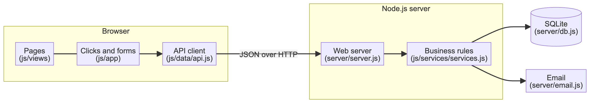
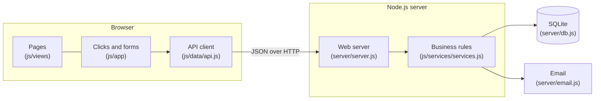
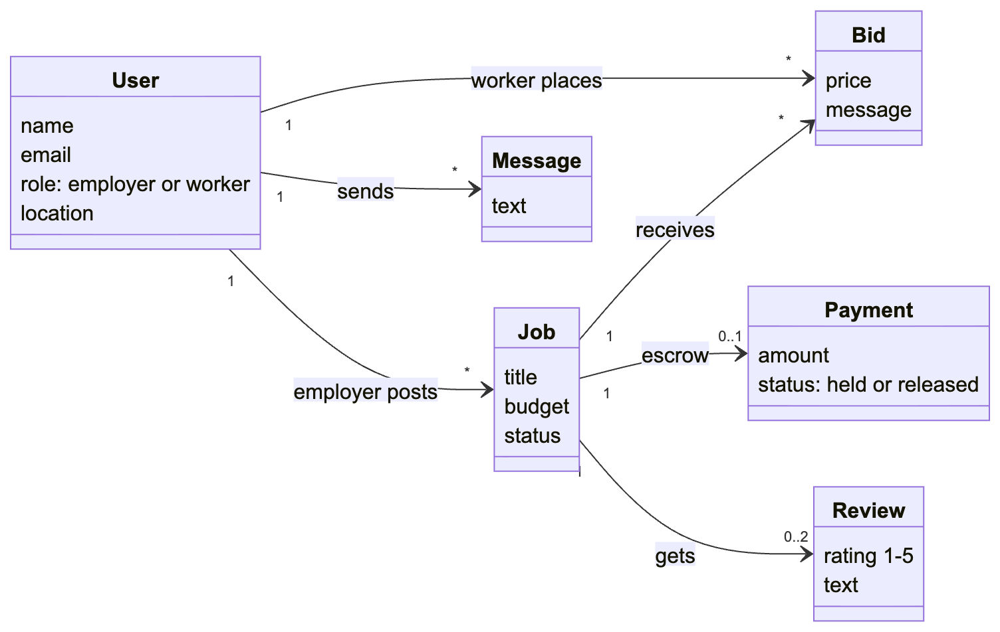
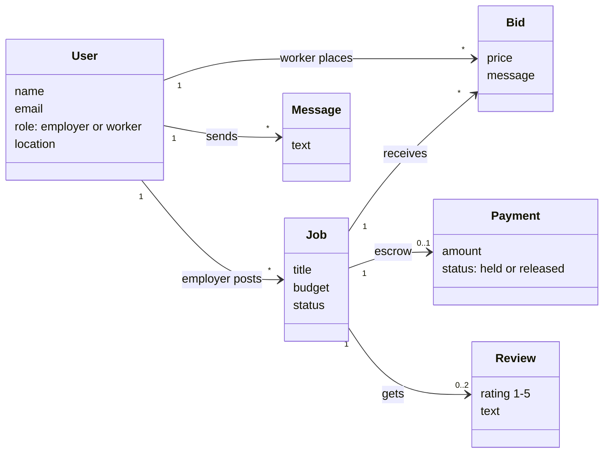
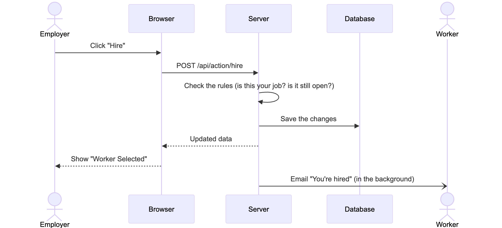
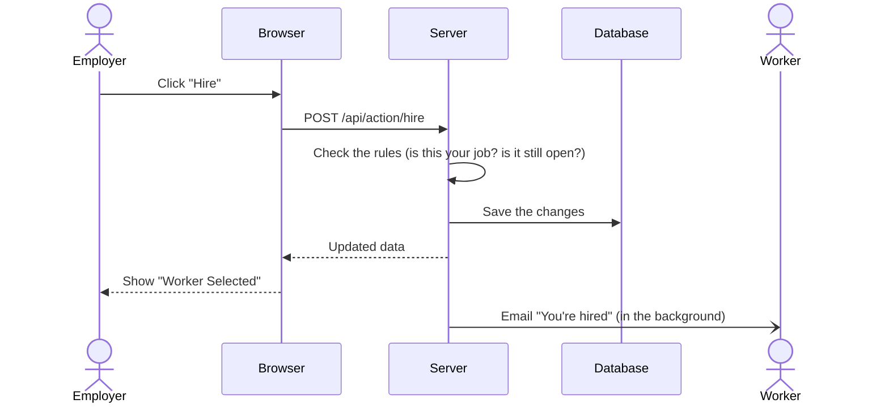
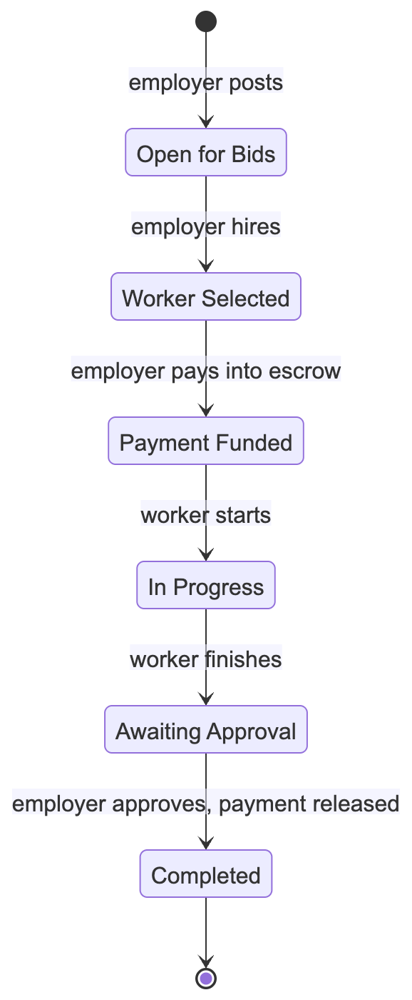
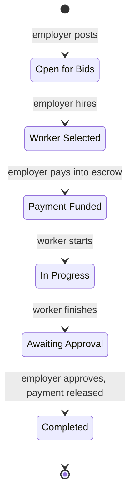

# Nearhand Architecture (Simple Version)

Nearhand is a website where **employers** post local jobs and nearby **workers** bid on them. This page explains how it is built in five diagrams. For full detail, see [ARCHITECTURE.md](ARCHITECTURE.md). Image versions of every diagram are in [diagrams/](diagrams/).

## In one paragraph

The browser shows the pages; a small Node.js server holds the data and enforces the rules. When the page loads, the browser asks the server for all the data the user is allowed to see. When the user does something (post a job, bid, hire), the browser asks the server to run that one rule, and the server sends back the updated data. Data is saved in a SQLite database file. The server also sends emails (Resend) and looks up city locations (OpenStreetMap).

---

## 1. The big picture

Who uses the system and what it connects to.

## 2. Main parts

The browser handles what you see; the server handles the data and the rules.

| Part | Job |
|---|---|
| Pages | Turn the data into HTML (home, job search, job details, dashboard, messages...). |
| Clicks and forms | React to buttons and forms, then call a business rule. |
| API client | Sends each request to the server and keeps the latest data. |
| Web server | Serves the files, keeps users signed in (cookie), and passes requests to the rules. |
| Business rules | Decide who may do what, e.g. only the job's owner can hire. |
| SQLite | Stores users, jobs, bids, payments, reviews, notifications and messages. |

## 3. Main data

The main kinds of records and how they relate.

## 4. What happens when you click a button

Example: an employer hires a worker.

## 5. Life of a job

Every job moves through the same six steps.

---

## Key points

- **The server is in charge.** The browser can't skip rules or act as another user.
- **No extra packages.** The server uses only built-in Node.js features, including its SQLite database.
- **Same rules everywhere.** The rule files in `js/` run on the server too.
- **Simulated money.** Payments and escrow are fake; no real money moves.
- **Limits:** one server process, all data held in memory, and the browser re-downloads its data on each refresh.

## How this was made

The architecture was worked out by Claude Code (an AI coding assistant), which read the source code and drew the diagrams. Prompts used:

1. "Use gen AI tools and prompts to determine the current architecture of that system. Include class diagrams, component diagrams, etc."
2. "Make a much more simplified version of the architecture and give me the diagrams as well."
