# Nearhand: Current Architecture

This document describes the architecture of the Nearhand prototype **as it exists in the code today** (commit `5377582` plus the uncommitted `server/`, `js/` and `css/` folders). It was recovered from the source with a generative AI coding assistant (Claude Code), using the prompts listed in [How this was produced](#how-this-was-produced). Every diagram is written in [Mermaid](https://mermaid.js.org/), so it renders directly on GitHub and can be edited as text.

Contents

1. [Architecture at a glance](#1-architecture-at-a-glance)
2. [System context diagram](#2-system-context-diagram)
3. [Container diagram](#3-container-diagram)
4. [Component diagram: server](#4-component-diagram-server)
5. [Component diagram: browser client](#5-component-diagram-browser-client)
6. [Class diagram: domain model](#6-class-diagram-domain-model)
7. [Class diagram: code modules](#7-class-diagram-code-modules)
8. [Database schema (ER diagram)](#8-database-schema-er-diagram)
9. [Sequence diagrams](#9-sequence-diagrams)
10. [State diagrams](#10-state-diagrams)
11. [Deployment diagram](#11-deployment-diagram)
12. [Architectural decisions and observations](#12-architectural-decisions-and-observations)
13. [How this was produced](#how-this-was-produced)

---

## 1. Architecture at a glance

| Aspect | What the code does |
|---|---|
| Style | Client/server **single-page application**. A thin JSON API in front of an in-memory domain model with write-through persistence. |
| Server | Node.js 22.13+, **no npm dependencies**: `node:http`, `node:sqlite`, `node:vm`, `node:crypto`. |
| Client | Plain HTML, CSS and non-module JavaScript files sharing one global scope; hash-based routing; HTML built from template strings. |
| Shared code | The same business-rule files (`constants`, `schedule`, `queries`, `services`) run in the browser *and* on the server. The server loads them into a Node `vm` sandbox. |
| API | Two endpoints: `GET /api/state` (everything this user may see) and `POST /api/action/:name` (run one business rule). An RPC style, not REST. |
| Persistence | SQLite, one table per collection, each row is `(id, data JSON)`. The whole data set lives in memory; `save()` writes only changed rows. |
| Auth | Random 48-hex session token in an `HttpOnly` cookie; sessions stored in SQLite; passwords hashed with scrypt. |
| External services | Resend (email), OpenStreetMap Nominatim (geocoding), OpenStreetMap tiles and Leaflet from cdnjs (maps), Google Fonts. |

---

## 2. System context diagram

Who uses Nearhand and which outside systems it depends on (C4 level 1).

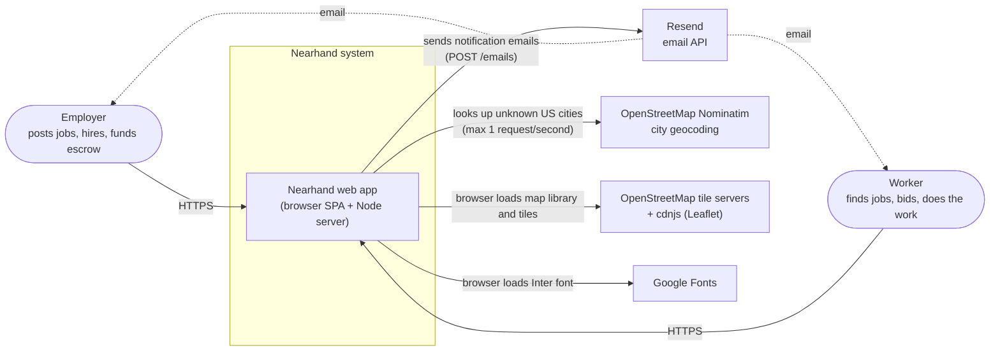

---

## 3. Container diagram

The deployable pieces and how they talk (C4 level 2).

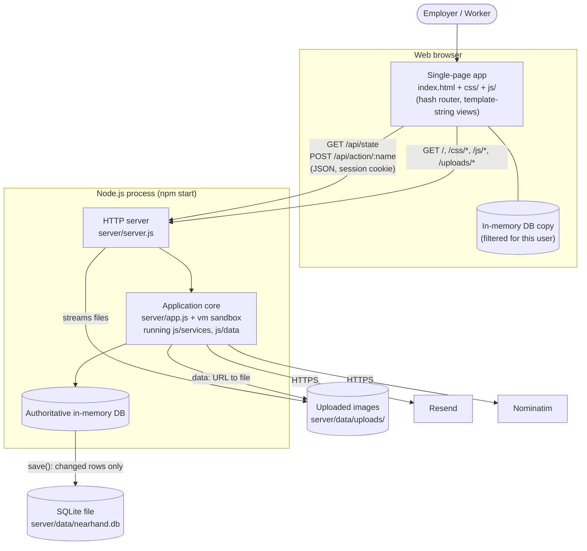

---

## 4. Component diagram: server

Each box is one file in `server/`, or a group of shared files loaded into the sandbox.

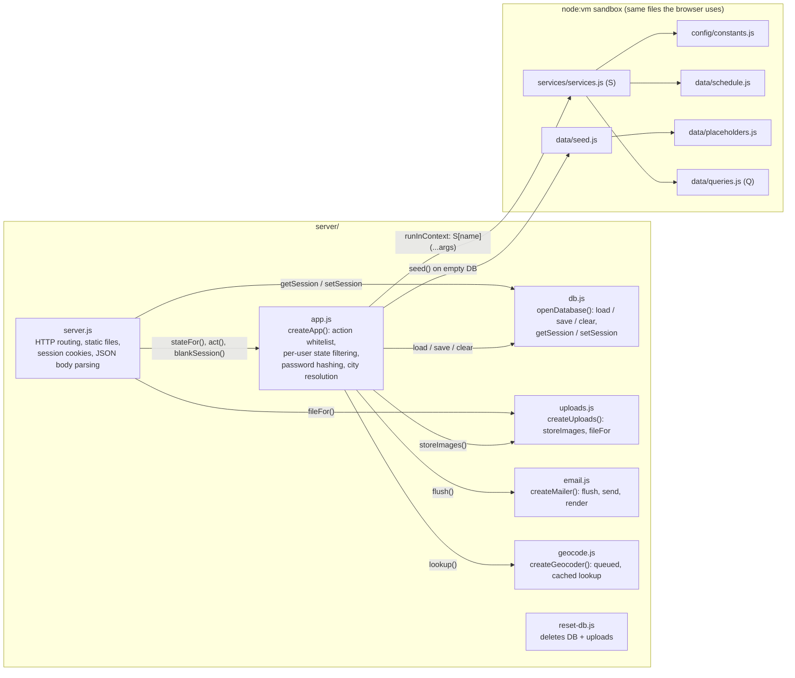

**Request pipeline inside `app.act(name, args, session)`**

1. Reject unknown actions. Only names in `MEMBER_ACTIONS` (signed-in) or `PUBLIC_ACTIONS` can run.
2. For member actions, overwrite the "acting user" argument with `session.userId`, so a browser cannot act as someone else.
3. If the action carries a city (`signup`, `saveJob`, `saveSettings`), normalise it through `Q.city()` or the Nominatim geocoder.
4. Replace every `data:image/...` string in the arguments with a saved file URL (`uploads.storeImages`).
5. Run the business rule `S[name]` synchronously with `DB.session` pointing at this browser's session.
6. Strip password hashes from the result, then email pending notifications in the background (`mailer.flush`).

---

## 5. Component diagram: browser client

The client is layered by folder. `index.html` loads the layers in this order, and a layer may use anything loaded before it.

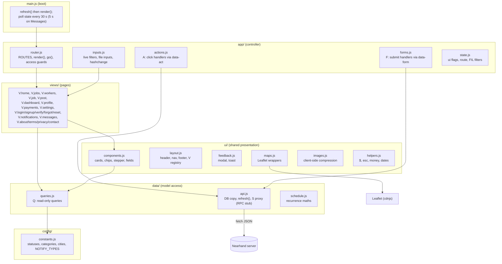

**Key idea: the `S` proxy.** In the browser, `S` is not the real business-rule object. It is a JavaScript `Proxy` in `js/data/api.js` that turns any call `S.hire(bidId, me.id)` into `POST /api/action/hire` with `{ args: [bidId, me.id] }`, swaps in the fresh state that comes back, and returns the rule's `{ ok, value | error }` result. The views and controllers therefore call business rules exactly as if they were local, while the real `S` from `services.js` only ever runs on the server.

---

## 6. Class diagram: domain model

The data model is documented in `js/config/constants.js` and enforced by `js/services/services.js`. The records are plain JSON objects (no JavaScript classes), so the diagram shows their fields and relationships.

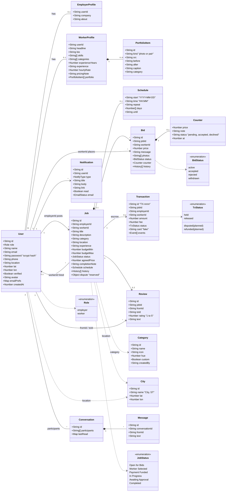

**Invariants enforced by the services layer** (`js/services/services.js`)

- Only `employer` users can post, edit, delete, counter, hire, fund and confirm; only `worker` users can bid, start and complete.
- A worker has at most one bid per job (re-bidding revises it).
- Hiring accepts one bid, rejects every other active bid, and closes bidding.
- A `Transaction` is created only when a job moves from *Worker Selected* to *Payment Funded*, and is released only on *Completed*.
- Each party can leave at most one review per completed job, and only about the other party.
- Messaging is only allowed between a verified employer and a verified worker (`Q.canMessage`).

---

## 7. Class diagram: code modules

Nearhand is not written with `class` declarations. Each module is either a **factory function returning an object** (server) or a **global singleton object** (shared and client). This diagram treats each of those as a class to show responsibilities and dependencies.

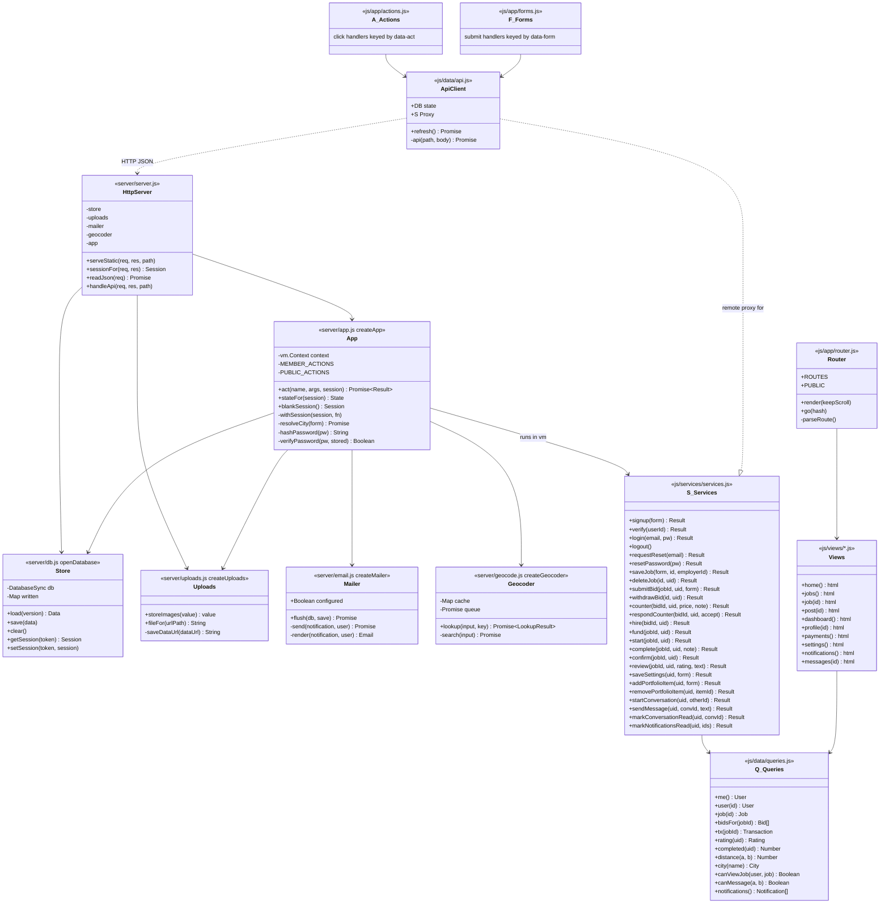

---

## 8. Database schema (ER diagram)

`server/db.js` creates one table per collection with the same two columns, plus `meta` and `sessions`. Relationships are **logical only**: they live inside the JSON `data` column and SQLite does not enforce them with foreign keys.

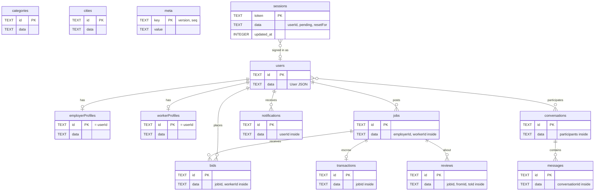

---

## 9. Sequence diagrams

### 9.1 Page load and navigation

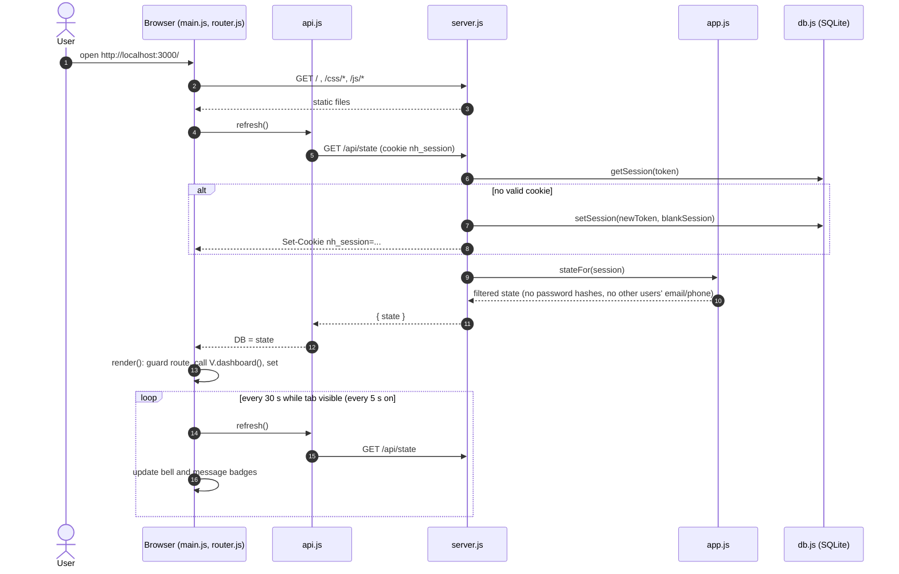

### 9.2 Running a business rule: employer hires a worker

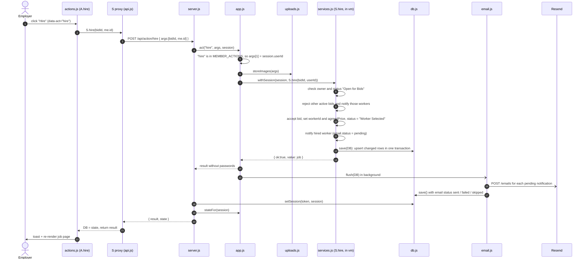

### 9.3 Signup with an unknown city

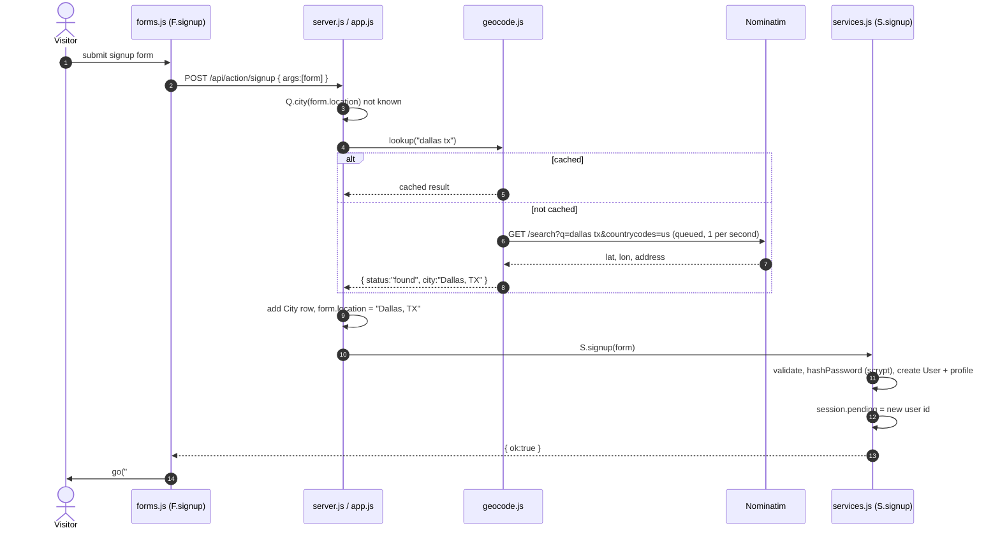

---

## 10. State diagrams

### 10.1 Job lifecycle

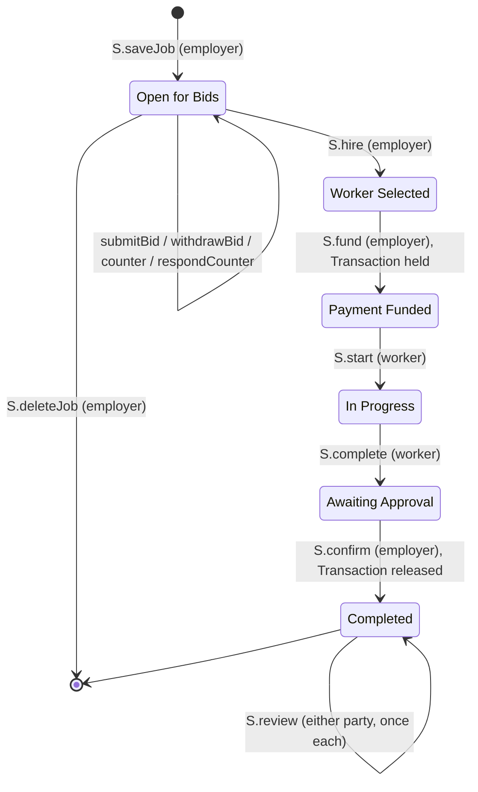

### 10.2 Bid and counter-offer

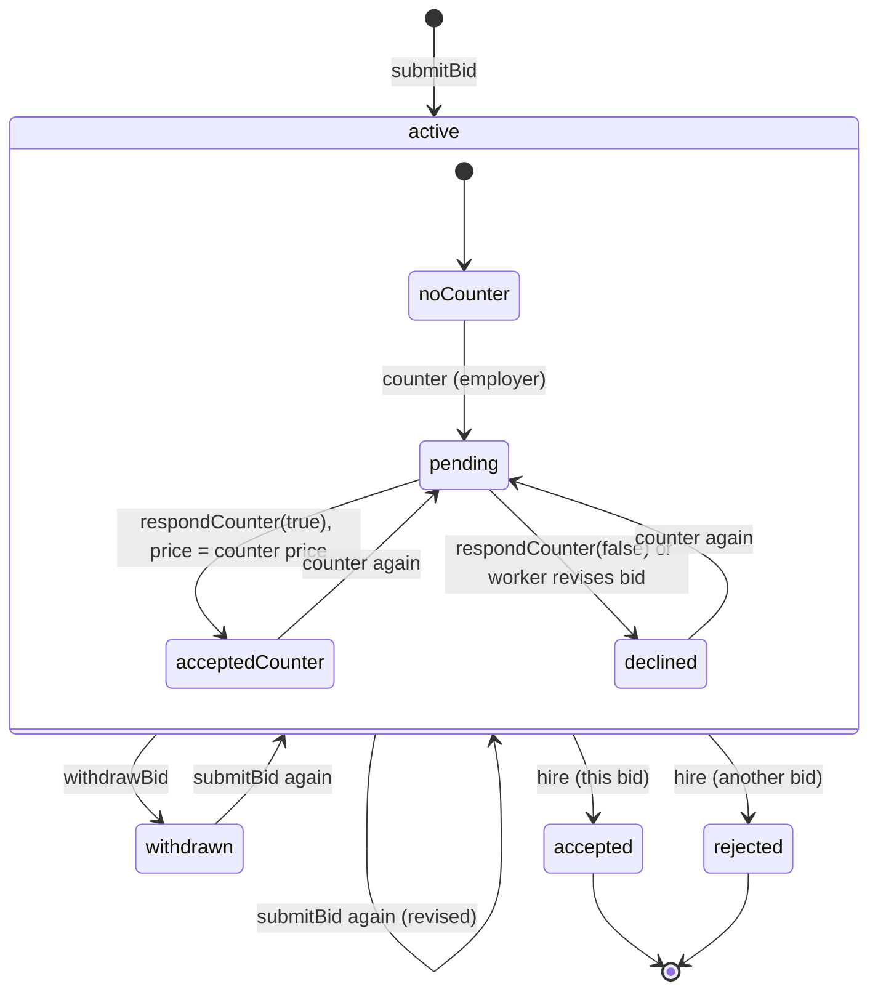

### 10.3 Escrow transaction and notification email

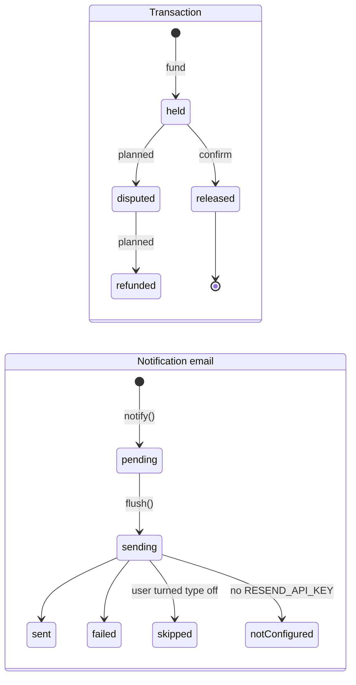

---

## 11. Deployment diagram

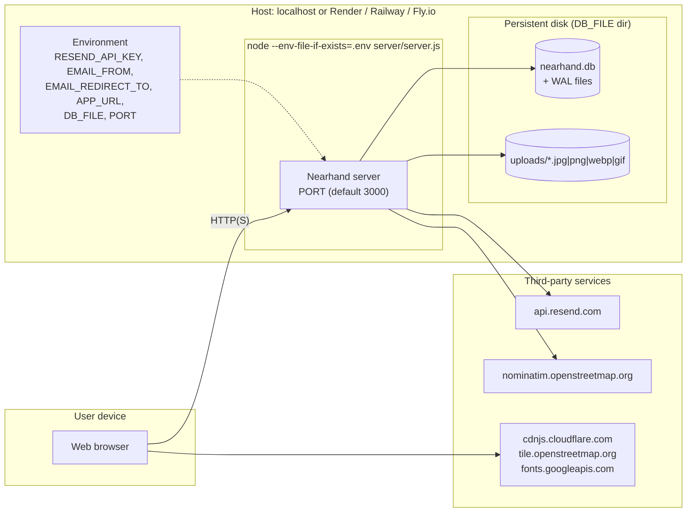

---

## 12. Architectural decisions and observations

**Decisions visible in the code**

| Decision | Where | Effect |
|---|---|---|
| Zero dependencies | `package.json` has no `dependencies`; only `node:*` modules | No install step, nothing to audit, but everything (HTTP routing, body parsing, cookies) is hand-written. |
| Shared rules run in a `vm` sandbox | `server/app.js` `SHARED_SCRIPTS` | One copy of the rules for client and server, without converting the browser scripts to modules. |
| Server is the source of truth | `MEMBER_ACTIONS` fills in the acting user from the session | The browser cannot bypass rules or impersonate another user. |
| Read-everything state endpoint | `GET /api/state`, filtered by `stateFor()` | Simple client (no per-page fetching); payload grows with the data set. |
| Document-style tables | `db.js`: `(id, data JSON)` per collection | Schema changes need no migrations, but there are no foreign keys or indexes on fields, and a `DB_VERSION` bump discards all data. |
| In-memory data, diff-based writes | `db.js` `written` map | Fast reads; the whole data set must fit in memory, and only one server process can run. |
| Synchronous rules, single-threaded Node | `withSession()` comment in `app.js` | Swapping `DB.session` per request is safe only because rules never `await`. |
| Images as content-addressed files | `uploads.js` (SHA-256 file names) | Small JSON payloads, duplicate uploads stored once, immutable caching. |

**Gaps and drift found while recovering the architecture**

- **Messaging polls instead of pushing.** `Conversation`/`Message` records, `S.startConversation` and `S.sendMessage`, the `#/messages` route and `js/views/messages.js` now exist. Instead of a push channel (WebSocket or server-sent events), the Messages page polls `GET /api/state` every 5 seconds (`js/main.js`), and each poll resends the user's entire visible data set, not just new messages.
- **Leftover constant.** `STORE_KEY` in `js/config/constants.js` is no longer used; it dates from when data was kept in browser `localStorage`.
- **Scalability limits.** Single process, whole data set in memory, and `GET /api/state` returns every job, bid and review to each signed-in user on every page change, every 30-second poll, and every 5 seconds while Messages is open.
- **No automated tests**, and no foreign-key integrity in the database; the services layer is the only place relationships are checked.
- **Session table is never pruned.** A new row is created for every cookieless request (including bots), and old rows are never deleted.

---

## How this was produced

The architecture was reverse-engineered from the source with **Claude Code** (Anthropic's AI coding assistant, model Claude Opus 5.5) running in the repository. The assistant read the files itself (`server/*.js`, `js/**/*.js`, `index.html`, `package.json`, `README.md`) and then wrote the diagrams. The prompts below can be reused with any AI coding assistant that can read the repository, such as Claude Code, GitHub Copilot Chat or Cursor.

**Prompt used**

> Use gen AI tools and prompts to determine the current architecture of that system. Include class diagrams, component diagrams, etc.

**Follow-up prompts that reproduce each section**

1. *Inventory:* "List every source file in this repository with its line count, and summarise in one sentence what each file is responsible for. Identify the runtime, frameworks and external services it uses."
2. *Context and containers:* "Draw a C4 system context diagram and a container diagram in Mermaid for this app. Include every external HTTP service the code calls and every place data is stored."
3. *Components:* "For `server/` and for `js/`, draw a Mermaid component diagram showing each module and the functions it calls in other modules. Follow `index.html`'s script order for the browser layers."
4. *Domain classes:* "From the data model comment in `js/config/constants.js` and the rules in `js/services/services.js`, draw a Mermaid class diagram of the domain entities with fields, enumerations, multiplicities and relationships. List the invariants the services enforce."
5. *Code structure:* "The code has no `class` declarations. Treat each factory function and global singleton (`S`, `Q`, `A`, `F`, `V`, `createApp`, `openDatabase`, ...) as a class and draw a Mermaid class diagram of their public methods and dependencies."
6. *Data:* "Draw a Mermaid ER diagram of the SQLite tables `server/db.js` creates, marking which relationships are only logical (inside the JSON column)."
7. *Behaviour:* "Write Mermaid sequence diagrams for (a) first page load, (b) an employer hiring a worker, end to end through the server, and (c) signing up with a city the app has never seen. Write state diagrams for the job lifecycle, bids and counter-offers, escrow transactions and notification emails."
8. *Review:* "Compare the code with the README. List architectural decisions, their trade-offs, and anything that is partly implemented, unused, or inconsistent."

**Verification.** Each claim was checked against the code it cites (file and function names are given throughout so a reader can do the same). AI-generated diagrams can still contain mistakes, so treat the source as authoritative if they ever disagree.
